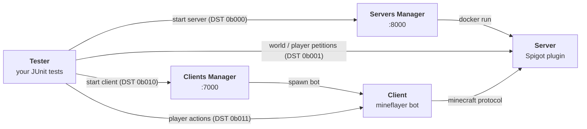

# WatchWolf

[](https://watchwolf.dev/)
[](LICENSE)

**WatchWolf is an integration-testing environment for Minecraft plugins.** You describe the
servers you want (type, version, plugins, world, config files) and the players that should join
them; WatchWolf starts *real* Minecraft servers and *real* clients, drives them from your JUnit
tests, and tears everything down afterwards.

```java
@ParameterizedTest
@ArgumentsSource(WorldInteractionPetitionsShould.class)
public void breakBlock(TesterConnector connector) throws Exception {
    String username = connector.getClients()[0];
    ExtendedClientPetition client = connector.getClientPetition(username);

    Position target = client.getPosition().add(0, -1, 0);
    client.breakBlock(target);

    assertEquals(Blocks.AIR, connector.server.getBlock(target));
}
```

This repository holds the **standard**: the wire protocol every WatchWolf module speaks, the
machine-readable API definitions, and the setup script that installs a working environment.
The modules themselves live in their own repositories (see [Implementations](#implementations)).

---

## Table of contents

- [Architecture](#architecture)
- [Quick start](#quick-start)
- [The API](#the-api)
- [Working on the standard](#working-on-the-standard)
- [Implementations](#implementations)
- [Repository layout](#repository-layout)
- [Contributing](#contributing)

---

## Architecture

WatchWolf splits into five programs, each with a single responsibility. Every arrow below is a
TCP socket speaking the [WatchWolf API](#the-api).



| Module | Responsibility | Language | Repository |
| --- | --- | --- | --- |
| **Tester** | Entry point. Orchestrates setup/teardown and runs your tests. | Java 8 | [WatchWolf-Tester fork](https://github.com/sarhatabaot/WatchWolf-Tester) |
| **Servers Manager** | Provides Minecraft servers on demand (one Docker container each) and frees them afterwards. | Java 17 | [WatchWolf-ServersManager fork](https://github.com/sarhatabaot/WatchWolf-ServersManager) |
| **Server** | The Minecraft server itself. A Spigot plugin that executes the Tester's commands in-game. | Java 8 | [WatchWolf-Server fork](https://github.com/sarhatabaot/WatchWolf-Server) |
| **Clients Manager** | Same as the Servers Manager, but for players. Starts bots and connects them to a server. | Python 3 | [WatchWolf-Client](https://github.com/miranda1000/WatchWolf-Client) |
| **Client** | A headless Minecraft client that can move, mine, chat and record video. | Python 3 + Node | [WatchWolf-Client](https://github.com/miranda1000/WatchWolf-Client) |

Two supporting repositories complete the picture:

| Module | Responsibility | Repository |
| --- | --- | --- |
| **Core** | Shared entities (blocks, items, entities, plugins) and the RPC runtime + code generator. | [WatchWolf-Core](https://github.com/watch-wolf/WatchWolf-Core) |
| **Material Getter** | Spigot plugin that extracts every block/item of a Minecraft version and generates the `blocks.special` classes consumed by Core and Tester. | [WatchWolf-MaterialGetter](https://github.com/miranda1000/WatchWolf-MaterialGetter) |

### Ports

| Port | Used by |
| --- | --- |
| `8000` | Servers Manager (accepts Tester connections) |
| `8001+` | One Minecraft server per **pair** of ports: `N` is the Minecraft port, `N+1` is the WatchWolf Server socket |
| `7000` | Clients Manager (accepts Tester connections) |
| `7001+` | One client per **pair** of ports: `N` is the client socket, `N+1` streams the recorded images |

---

## Published installation

The [`WatchWolfSetup.sh`](WatchWolfSetup.sh) script installs and runs everything the Tester needs
(the Servers Manager and the Clients Manager). It requires **Ubuntu** and **Docker**; on Windows,
see [how to install Linux on Windows with WSL](https://learn.microsoft.com/en-us/windows/wsl/install).
This path clones upstream repositories and downloads published artifacts. For this fork's local
feature branches, use [Development setup for the sarhatabaot forks](#development-setup-for-the-sarhatabaot-forks).

1. **Download the script**

   ```bash
   wget https://raw.githubusercontent.com/watch-wolf/WatchWolf/main/WatchWolfSetup.sh
   ```

2. **Build**

   ```bash
   bash WatchWolfSetup.sh --build --runtime itzg
   ```

   This clones the Servers Manager and Clients Manager, downloads the "usual plugins" and
   builds their control-plane images. The `itzg` runtime downloads a supported Paper build when
   a test first requests it, so setup does not build Minecraft server JARs. Use
   `--runtime legacy` to retain the older JAR preparation flow. The script uses published
   Servers Manager artifacts; use the development workflow below to test local changes.

3. **Install** *(optional — makes `watchwolf` available everywhere and starts it at boot)*

   ```bash
   bash WatchWolfSetup.sh --install
   ```

4. **Run**

   ```bash
   bash WatchWolfSetup.sh --run --runtime itzg
   ```

Once it is up, point your tests at the machine running it (see the Tester's
[configuration file](https://github.com/sarhatabaot/WatchWolf-Tester)) and you are ready to go.

### Script options

| Flag | Applies to | Meaning |
| --- | --- | --- |
| `--build` | — | Clone, compile and prepare the environment |
| `--install` | — | Symlink to `/bin/watchwolf` and register the startup service |
| `--uninstall` | — | Undo `--install` |
| `--run` | — | Start the Servers Manager and Clients Manager containers |
| `--path <dir>` | all | Base directory (default `$HOME/WatchWolf`) |
| `--dev` | `--build` | Clone the `dev` branches instead of `master` |
| `--threads <n>` | `--build` | Parallel Spigot build containers (default `1`) |
| `--skip-spigot-build` | `--build` | Skip building Spigot; drop the jars in `<path>/ServersManager/ci/release/server-types/Spigot` yourself |
| `--runtime legacy\|itzg` | `--build`, `--install`, `--run` | Choose provisioning; defaults to `itzg`. The explicit flag overrides `WATCHWOLF_MINECRAFT_RUNTIME`. |
| `--disable-startup` | `--install` | Do not launch WatchWolf at boot |

---

## Development setup for the sarhatabaot forks

From the workspace parent directory, use the **local source and artifacts** from these sibling
repositories. The current feature
branches are `feature/docker-runtime-modernization` in `WatchWolf` and
`feature/itzg-minecraft-runtime` in `WatchWolf-ServersManager`; `WatchWolf-Server` and
`WatchWolf-Tester` remain on `dev`. These branches are local until pushed, so use the existing
workspace if a fresh clone cannot see them. For a new workspace, clone the forks from
`github.com/sarhatabaot`, then check out the feature branches after they are published:

```powershell
git clone https://github.com/sarhatabaot/WatchWolf.git
git clone https://github.com/sarhatabaot/WatchWolf-ServersManager.git
git clone https://github.com/sarhatabaot/WatchWolf-Server.git
git clone https://github.com/sarhatabaot/WatchWolf-Tester.git
```

Keep the repositories side by side. Do not use `WatchWolfSetup.sh --build` for this workflow:
that script reclones upstream Servers Manager and its release build downloads an upstream JAR.
Use Docker Engine on Linux or Docker Desktop with Linux containers on Windows. The commands below
use PowerShell from the existing workspace; on Linux, use the corresponding `mkdir -p`, `cp`,
and `$PWD` shell syntax.

1. **Build the local WatchWolf-Server plugin.** Its fork requires
   `WatchWolf-Server/lib/spigot-1.16.5.jar` and Core `0.3.3`. The Server fork's
   `ci/build.sh` resolves Core through JitPack or the
   optional sibling `WatchWolf-Core` checkout. Supply the Spigot JAR before building; it is not
   checked into the fork. From the workspace parent in a Linux or WSL Bash terminal, run:

   ```bash
   cd WatchWolf-Server
   bash ci/build.sh --preclean
   ```

   This produces `target/WatchWolf-0.3.1-1.8-LATEST.jar`. Use that locally built file so
   Minecraft loads the forked plugin. The Servers Manager and Server currently require
   different Core versions: **0.3.1 for Servers Manager, 0.3.3 for Server**.

2. **Build the local Servers Manager.** From the workspace parent in PowerShell, enter the
   sibling `WatchWolf-ServersManager` checkout,
   install its Core `0.3.1` JAR into the ignored `lib/` directory, run Maven, and copy the
   assembled manager and forked plugin into the Compose build/mount paths:

   ```powershell
   cd WatchWolf-ServersManager
   New-Item -ItemType Directory -Force lib,ci/release/usual-plugins,ci/release/tmp,ci/release/logs | Out-Null
   docker run --rm -v "${PWD}/lib:/out" maven:3.9-eclipse-temurin-17 curl -fL https://github.com/watch-wolf/WatchWolf-Core/releases/download/v0.3.1/watchwolf-core-0.3.1.jar -o /out/watchwolf-core-0.3.1.jar
   docker run --rm -v "${PWD}:/compile" -w /compile maven:3.9-eclipse-temurin-17 mvn -B clean package
   Copy-Item target/watchwolf-servers-manager-0.3.3.jar ci/release/ServersManager.jar
   Copy-Item ../WatchWolf-Server/target/WatchWolf-0.3.1-1.8-LATEST.jar ci/release/usual-plugins/
   ```

   The manager's Maven `clean` phase installs the Core JAR from `lib/`. Rebuild and recopy
   `ServersManager.jar` after changing manager code; rebuild and recopy the plugin after changing
   Server code. These JARs and runtime directories are ignored by Git. The itzg provider needs
   no `server-types/<Type>/<version>.jar`; the explicit `legacy` fallback does.

3. **Build the Clients Manager dependency.** This workspace has no Clients Manager fork or
   checkout, so Compose uses its upstream image built from a separate checkout:

   ```powershell
   git clone --branch dev https://github.com/rogermiranda1000/WatchWolf-Client.git ../WatchWolf-Client
   docker build -t clients-manager:latest ../WatchWolf-Client
   ```

   Skip the clone if that directory already exists. No Minecraft instance is a Compose service.

4. **Start the local control plane.** From this fork's `WatchWolf` checkout:

   ```powershell
   cd ../WatchWolf
   Copy-Item .env.example .env
   docker compose config --quiet
   docker compose up --build -d
   docker compose logs -f servers-manager
   ```

   `.env` selects `itzg` by default. `WATCHWOLF_ITZG_TAG=auto` uses the tested Java image
   variant for Paper `1.19`, `1.20.2`, or `1.20.6`; an explicit tag overrides it. Set
   `WATCHWOLF_MACHINE_IP` and `WATCHWOLF_PUBLIC_IP` to a reachable host address for remote
   Testers. For `legacy`, set `WATCHWOLF_MINECRAFT_RUNTIME=legacy` and make
   `WATCHWOLF_SERVERS_MANAGER_RELEASE_DIR` an absolute host path.

5. **Use the forked Tester.** Build `WatchWolf-Tester` from its sibling checkout, then configure
   a test to target `127.0.0.1` and one of the Paper versions above:

   ```powershell
   cd ../WatchWolf-Tester
   docker run --rm -v "${PWD}:/compile" -w /compile maven:3.9-eclipse-temurin-17 mvn -B package
   ```

   For a live JUnit run, temporarily narrow the relevant fixture, such as
   `src/test/java/server_starter/resources/basic.yaml`, to a supported request:

   ```yaml
   provider: "127.0.0.1"
   server-type:
     - Paper:
         - "1.20.2"
   plugin: "WatchWolf"
   ```

   Run the selected test **on the host**, where `127.0.0.1` reaches the published Compose
   ports, using a local JDK and Maven:

   ```powershell
   mvn -Dmaven.test.skip=false -Dtest=ServerStarterShould test
   ```

   Restore the tracked fixture afterward. Other fork fixtures request older Paper and Spigot
   versions; use `legacy` with their JARs before running them. The manager listens on `8000`,
   Clients Manager on `7000`, and spawned Minecraft instances use port pairs from `8001`.

Use `docker compose down` from `WatchWolf` to stop the control plane. Instance volumes are
removed after their servers stop; retained logs are under
`WatchWolf-ServersManager/ci/release/logs/`. The manager alone receives the Docker socket.
Windows Docker Desktop with Linux containers has passed the manager and Tester workflow; Linux
Docker Engine and a local rebuild of the Server fork still need validation.

---

## The API

Every WatchWolf module talks over TCP using the same framing. A packet starts with a 16-bit
header (sent LSB first) followed by the operation's arguments:

```
 15                                4   3   2       0
+------------------------------------+---+---------+
|             operation              | r |   DST   |
+------------------------------------+---+---------+
|                  arguments ...                   |
+--------------------------------------------------+
```

- **DST** — which module the packet is for. When **r** is set, DST means *origin* instead.

  | DST | Destination |
  | --- | --- |
  | `0b000` | Servers Manager petition |
  | `0b001` | Server petition |
  | `0b010` | Clients Manager petition |
  | `0b011` | Client petition |
  | `0b1XX` | *Reserved* |

- **r** (response) — `0` for a request, `1` for a reply or an asynchronous notification.
- **operation** — the request itself; the set of operations depends on the DST. Operation
  `0b000000000000` is always a NOP (a keep-alive, so a long test is not dropped for inactivity).

Arguments use language-independent encodings (characters, booleans, doubles, strings, arrays,
files, positions, blocks, items, entities, containers…). **The full specification lives in
[`API/API.pdf`](API/API.pdf)** — that document is the source of truth for the protocol.

### Machine-readable definitions

[`API/definitions/`](API/definitions) mirrors part of that specification as JSON, one file per
module. These are consumed by tooling rather than read by hand:

- `api-docs.py` renders them into byte-field SVGs and a Markdown page for the website.
- WatchWolf-Core's `ci/rpc-gen.sh` generates the Java RPC stubs from them.

Today only [`servers_manager.json`](API/definitions/servers_manager.json) exists; the other
modules are still described only in the PDF.

---

## Working on the standard

### Rendering the definitions to docs

```bash
sudo docker build -f api-docs.Dockerfile --tag api-docs-builder .
sudo docker run -i --rm --name API-docs-builder \
    -v ./API/definitions:/app/API/definitions api-docs-builder:latest
```

This regenerates the `.md` and `.svg` files next to each definition. **Do not edit those by
hand** — edit the `.json` and re-run the container.

### Building the PDF

`API/API.tex` uses `glossaries` and `apacite`, so it needs the full four-pass build:

```bash
cd API
pdflatex -synctex=1 -interaction=nonstopmode API.tex
bibtex API
makeglossaries API
pdflatex -synctex=1 -interaction=nonstopmode API.tex
pdflatex -synctex=1 -interaction=nonstopmode API.tex
```

`API/A-Blocks.tex` (the block-type appendix) and `API/diagram.tex` are included from `API.tex`.

### The UML model

`Diagram.mdj` is a [StarUML](https://staruml.io/) model of the framework.

---

## Implementations

A full implementation uses these forked modules and upstream dependencies:

- [WatchWolf-Tester fork](https://github.com/sarhatabaot/WatchWolf-Tester) — JUnit 5 test harness
- [WatchWolf-ServersManager fork](https://github.com/sarhatabaot/WatchWolf-ServersManager) — Docker-backed server provider
- [WatchWolf-Server fork](https://github.com/sarhatabaot/WatchWolf-Server) — Spigot plugin
- [WatchWolf-Client](https://github.com/miranda1000/WatchWolf-Client) — Clients Manager & mineflayer client
- [WatchWolf-Core](https://github.com/watch-wolf/WatchWolf-Core) — shared entities and RPC runtime
- [WatchWolf-MaterialGetter](https://github.com/miranda1000/WatchWolf-MaterialGetter) — block/item class generator

---

## Repository layout

```
.
├── API/
│   ├── API.tex             # the specification (source of truth)
│   ├── API.pdf             # rendered specification
│   ├── A-Blocks.tex        # appendix: every block type and its properties
│   ├── diagram.tex         # the architecture figure included by API.tex
│   ├── glossaries.tex      # acronyms and glossary entries
│   ├── sample.bib          # bibliography
│   └── definitions/        # machine-readable API (JSON) + generated .md/.svg
├── api-docs.py             # definitions -> SVG/Markdown renderer
├── api-docs.Dockerfile     # container that runs api-docs.py
├── WatchWolfSetup.sh       # build / install / run the environment
└── Diagram.mdj             # StarUML model
```

Generated artefacts (`API/API-*.aux`, `API/definitions/*/`, …) are covered by `.gitignore`;
only the `.tex`, `.json`, the rendered `API.pdf` and the checked-in SVG/Markdown are tracked.

---

## Contributing

Found a problem or want a new operation in the protocol? Open an issue at
[watch-wolf/WatchWolf](https://github.com/watch-wolf/WatchWolf/issues). Changes to the protocol
should land in `API/API.tex` first, then in the JSON definitions, then in the implementations.

WatchWolf is MIT licensed (see [LICENSE](LICENSE)) and accepts sponsorship through
[GitHub Sponsors](https://github.com/sponsors/miranda1000).
