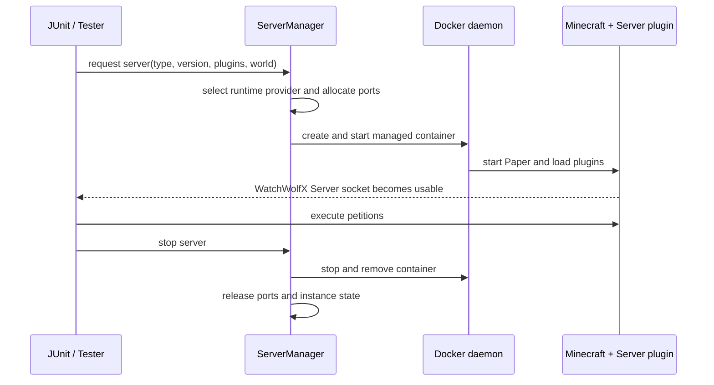

# Architecture

WatchWolfX separates test orchestration from disposable Minecraft workloads. The control plane is
long-lived; servers and clients exist only for a test lifecycle.

## Components

| Component | Runtime | Responsibility |
| --- | --- | --- |
| Tester | Java 8 bytecode | Describes requirements and drives test petitions |
| ServerManager | Java 17 | Creates, observes, stops, and removes Minecraft containers |
| Server | Java 8 bytecode | Runs inside Bukkit/Paper and executes server-side petitions |
| ClientsManager | Python 3.12 | Creates and controls headless Minecraft clients |
| Core | Java 8 bytecode | Shared entities, RPC runtime, and generated stubs |

## Request lifecycle



Readiness means the Minecraft server and WatchWolfX Server plugin are usable. Docker's `running`
state alone is not sufficient.

## Protocol boundaries

```text
Tester <-> ServerManager <-> Docker
   |
   +-----> WatchWolfX Server plugin
   |
   +-----> ClientsManager <-> headless clients
```

The runtime provider is internal to ServerManager. Switching between `legacy` and `itzg` must not
change the public Tester or Server protocol.

## Deployment boundary

Docker Compose owns only the long-lived services:

- ServerManager
- ClientsManager

ServerManager owns dynamically created Minecraft containers. They are not declared as static
Compose services, and they never receive the Docker socket.

## Cross-platform model

WatchWolfX targets Linux Docker Engine and Windows Docker Desktop with Linux containers. Nested
host bind mounts are deliberately avoided for itzg instance data because paths meaningful to the
Compose host are not automatically meaningful to sibling containers created through Docker.

For the detailed evidence behind these boundaries, see the
[runtime inventory](../project/engineering/runtime-inventory.md).
