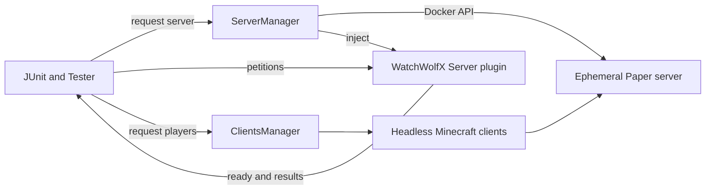

---
hide:
  - navigation
  - toc
---

Minecraft integration testing

# Test plugins on real servers without hand-building every runtime

WatchWolfX provisions disposable Minecraft servers and headless clients, drives them from JUnit,
and cleans them up when the test completes. It preserves the WatchWolf protocol while modernizing
the runtime, deployment, and release paths.

[Get started](user-guide/getting-started.md){ .md-button .md-button--primary }
[View on GitHub](https://github.com/sarhatabaot/WatchWolfX){ .md-button }

Release line 0.5.2
Paper via itzg
Linux containers

## Choose a path

-   **Run WatchWolfX**

    Start the control plane with Docker Compose and execute the included example against a real
    Paper server.

    [Install and run →](user-guide/getting-started.md)

-   **Configure the runtime**

    Select `itzg` or the legacy provider, choose the runtime image, and understand networking and
    storage settings.

    [Configuration →](user-guide/configuration.md)

-   **Understand the system**

    Follow a test request from Tester through ServerManager, Minecraft, WatchWolfX Server, and
    cleanup.

    [Architecture →](concepts/architecture.md)

-   **Contribute**

    Build each module, run the appropriate test layers, update protocol code, and prepare a
    release.

    [Development guide →](contributing/development.md)

## What WatchWolfX runs

!!! note "Independent project"

    WatchWolfX is an independently maintained hard fork. The Java package namespace remains
    `dev.watchwolf` for protocol compatibility, while published artifacts use `dev.watchwolfx`.

## Current defaults

| Area | Default | Notes |
| --- | --- | --- |
| Deployment | Docker Compose | Manages the long-lived control plane only |
| Minecraft runtime | `itzg` | Dynamically downloads the requested supported Paper version |
| Runtime image | `itzg/minecraft-server:auto` | Image and Minecraft versions are separate dimensions |
| Release version | `0.5.2` | Java modules and ClientsManager are validated together |
| Legacy runtime | Available | Retained as a compatibility fallback |

[See current engineering status](project/current-work.md)
